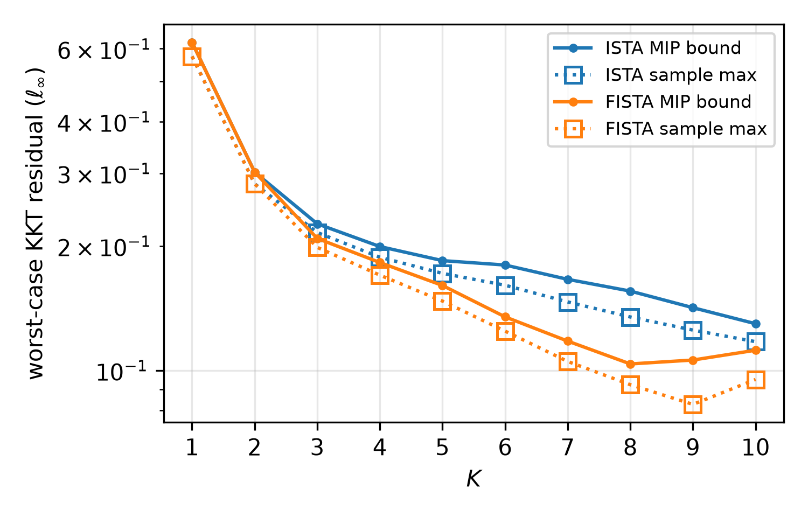
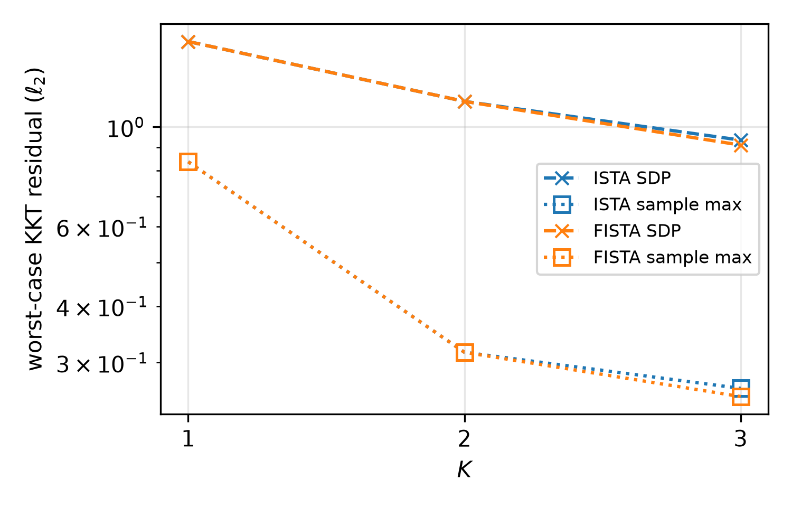

# Lasso: verifying ISTA and FISTA on a nonstrongly convex instance

ISTA and FISTA on a small Lasso whose data matrix is wide, so the problem is
not strongly convex. The setup follows the sparse coding experiment of
[Ranjan et al.](https://arxiv.org/abs/2412.11330) (Example 2.4 and Sec. 4.1),
with a dense $D$ for now. The large-scale code generation experiments are in
[`../lasso_codegen/`](../lasso_codegen/).

## Problem

$$
\begin{array}{ll}
\text{minimize} & \tfrac12 \lVert Du - x \rVert_2^2 + \lambda \lVert u \rVert_1,
\end{array}
$$

with parameter $x$, $\lambda = 0.1$ and $K = 1, \dots, 10$.

- **Data:** $D \in \mathbf{R}^{3 \times 5}$ has i.i.d. $N(0, 1/3)$ entries
  (seed 0), and its columns are normalized. $D^\top D$ has rank 3, so the
  problem is not strongly convex.
- **Parameter set:** draw 100 sparse $z^\star$, each entry $N(0,1)$ with
  probability 0.1 and otherwise 0. $X$ is the tightest box containing the
  points $Dz^\star$.
- **Initial iterate:** $s^0$ is the min-norm least-squares solution
  ($\lambda = 0$) for one of those samples.
- **Step:** $\eta = 1/\lambda_{\max}(D^\top D) = 0.366$ for both methods.

## Methods and the residual map $H$

| method | iteration | state $s^k$ | $H$ |
|---|---|---|---|
| ISTA | $u^{k+1} = T_{\lambda\eta}((I - \eta D^\top D)u^k + \eta D^\top x)$ | $u^k$ | $-(D^\top D - \eta^{-1} I)$ |
| FISTA | $u^{k+1} = T_{\lambda\eta}((I - \eta D^\top D)w^k + \eta D^\top x)$, $w^{k+1} = u^{k+1} + \gamma_k(u^{k+1} - u^k)$ | $(u^k, u^{k-1})$ | $-(D^\top D - \eta^{-1} I)\,[I,\ -\gamma_{K-2} I]$ |

- **FISTA momentum:** $\gamma_k = (\beta_k - 1)/\beta_{k+1}$, where
  $\beta_0 = 1$ and $\beta_{k+1} = (1 + \sqrt{1 + 4\beta_k^2})/2$, with
  $w^0 = u^0$.
- **Why the two methods are comparable:** the metric is
  $\lVert H(s^K - s^{K-1})\rVert_\infty$. For both methods it equals the
  KKT residual at $u^K$:
  - The prox step gives
    $(w^{K-1} - u^K)/\eta - D^\top(Dw^{K-1} - x) \in \partial\lambda\lVert u^K\rVert_1$.
  - Adding $D^\top(Du^K - x)$ gives $(\eta^{-1} I - D^\top D)(w^{K-1} - u^K)$.

  This residual is an element of $\partial\lambda\lVert u^K\rVert_1 + D^\top(Du^K - x)$,
  so it is zero at a solution. Setting $\gamma \equiv 0$ in the FISTA formula
  recovers ISTA.
- **$K = 1, 2$ are identical:** $\gamma_0 = 0$, so FISTA equals ISTA for the
  first two iterations. Momentum first affects $u^3$.

## Backends

- **MIP:** Gurobi with Gurobi OBBT, and `MIPGap` set to 5%. The reported value
  is Gurobi's best bound (`ObjBound`). It is a certified upper bound on the
  worst case, and so on every sample. The incumbent (`ObjVal`) is kept in the
  `objval` column of `results/milp_bounds.csv`.
- **Simulator:** 10,000 uniform samples of $x$ in $X$. The plot shows the
  sample maximum for each $K$.
- **SDP:** Clarabel with Gurobi OBBT, on the 2-norm, with all five cuts (RLT,
  triangle, ReLU envelope, cross, subgradient monotonicity). fomtools builds
  the cuts on its chordal cut set. `clarabel_dual.py` then couples every PSD
  cone into one cone over the whole moment matrix, and solves the dual so that
  Clarabel's own chordal decomposition can split it. This is the same patch as
  in the portfolio experiment; fomtools is unchanged. fomtools maximizes the
  squared 2-norm, and the tables report its square root.

## Results

### MILP (∞-norm, K = 1..10)

| K | ISTA MIP bound | ISTA sample max | FISTA MIP bound | FISTA sample max | ISTA MIP time | FISTA MIP time |
|---:|---:|---:|---:|---:|---:|---:|
| 1 | 0.6218 | 0.5751 | 0.6218 | 0.5751 | 0.01 s | 0.01 s |
| 2 | 0.3017 | 0.2827 | 0.3017 | 0.2827 | 0.02 s | 0.02 s |
| 3 | 0.2262 | 0.2155 | 0.2085 | 0.1984 | 0.04 s | 0.05 s |
| 4 | 0.1993 | 0.1878 | 0.1823 | 0.1700 | 0.12 s | 0.07 s |
| 5 | 0.1843 | 0.1716 | 0.1604 | 0.1471 | 0.25 s | 0.29 s |
| 6 | 0.1798 | 0.1607 | 0.1347 | 0.1244 | 0.51 s | 0.97 s |
| 7 | 0.1660 | 0.1464 | 0.1177 | 0.1051 | 0.32 s | 2.71 s |
| 8 | 0.1555 | 0.1346 | 0.1036 | 0.0923 | 0.57 s | 14.26 s |
| 9 | 0.1418 | 0.1251 | 0.1059 | 0.0827 | 1.42 s | 34.21 s |
| 10 | 0.1296 | 0.1173 | 0.1119 | 0.0950 | 2.22 s | 62.42 s |

- **FISTA pulls ahead from K = 3.** At K = 8 its certified bound is 33% below ISTA's (0.104 vs 0.156).
- **FISTA is not monotone.** Its bound rises after K = 8, and so does its incumbent: 0.099, 0.101, 0.107 for K = 8, 9, 10. Its sample max rises at K = 10. ISTA decreases at every K.
- **The bound equals the incumbent through K = 5 for ISTA and K = 6 for FISTA.** After that it sits up to 5% above the incumbent, as the gap allows.
- **FISTA MIPs get slower past K = 7.** They take 14 s at K = 8 and 62 s at K = 10, while every ISTA MIP stays under 3 s. The 5% gap barely changed these times, so most of the time is not spent closing the gap. The full run takes about 2 minutes.



### SDP (2-norm, K = 1..3)

| K | moment matrix | entries used (ISTA / FISTA) | ISTA SDP | ISTA sample max | FISTA SDP | FISTA sample max | ISTA time | FISTA time |
|---:|---:|---:|---:|---:|---:|---:|---:|---:|
| 1 | 24 × 24 | 285 / 285 of 300 | 1.5453 | 0.8362 | 1.5453 | 0.8362 | 0.21 s | 0.21 s |
| 2 | 39 × 39 | 665 / 715 of 780 | 1.1383 | 0.3161 | 1.1383 | 0.3161 | 1.1 s | 1.4 s |
| 3 | 54 × 54 | 1,245 / 1,295 of 1,485 | 0.9340 | 0.2630 | 0.9106 | 0.2521 | 1.9 s | 2.3 s |

- **The cuts halve the bound at K = 1** (3.23 without them, 1.55 with them),
  and the bound now falls with K instead of growing.
- **It is still loose.** It is 1.8x the sample max at K = 1 and 3.6x at K = 3.
  In the ∞-norm, the MIP incumbents are only 8–12% above the sample max, so
  most of this gap is likely the relaxation, not the sampling. There is no
  2-norm MIP to confirm this.
- **The pattern is nearly dense.** At K = 3, 84–87% of the moment-matrix entries
  are used, so Clarabel's decomposition has little to split.
- **Every solve ended "AlmostSolved"**, meaning reduced accuracy (the `status`
  column of `results/sdp_bounds.csv`). A certified bound would need a
  feasibility check or a certified dual bound.
- **The whole study takes about 8 s** at a peak of about 200 MB.



## Reproduce

```sh
cd lasso/lasso_verify
../../.venv/bin/python verify.py milp   # results/milp_bounds.csv (about 2 min)
../../.venv/bin/python verify.py sdp    # results/sdp_bounds.csv (about 8 s)
../../.venv/bin/python check.py         # sanity checks
../../.venv/bin/python plot.py          # results/lasso_{milp,sdp}.{pdf,png} and *_wide.csv
```

`check.py` confirms three things:
- Both methods reach the CVXPY (Clarabel) Lasso objective value. Objective
  values are compared rather than $u$, because the minimizer need not be unique.
- $H(s^k - s^{k-1})$ equals the KKT residual computed directly from $u^k$.
- The simulator matches the NumPy reference, and sampled residual ≤ MIP or SDP
  bound for every study, method and $K$.
