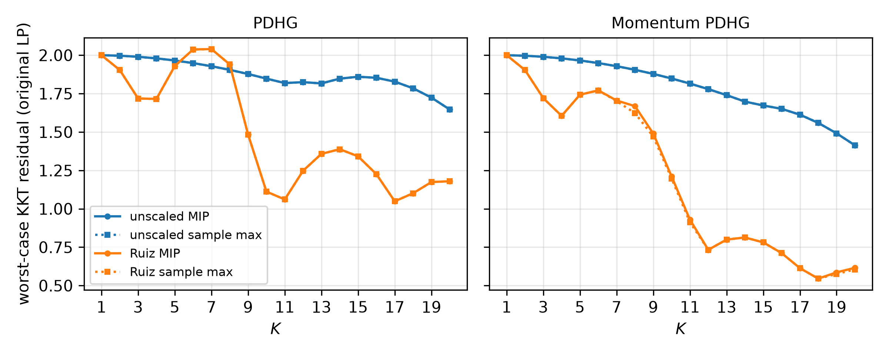

# Network flow: verifying equilibrated PDHG in unscaled variables

PDHG and momentum PDHG on a min-cost network flow with gains, verified with and
without two-sided Ruiz equilibration. Unlike NNLS, scaling the rows of an LP leaves
its solution unchanged, so here both rows and columns are scaled. Real solvers
(e.g. PDLP) equilibrate internally but check termination on the original problem.
This experiment verifies the equilibrated methods in exactly that way.

## Problem

$$
\begin{array}{ll}
\text{minimize} & \mu^\top z \\
\text{subject to} & A_s z \le b_s,\quad A_d z = x,\quad 0 \le z \le c,
\end{array}
$$

on a complete bipartite graph with $n_s = 3$ supply nodes, $n_d = 4$ demand nodes
and $n_e = 12$ edges.

- **Gains:** one unit shipped on edge $e = (i, j)$ leaves supply node $i$ and
  delivers $g_e$ units at demand node $j$, so $A_s[i, e] = 1$ and
  $A_d[j, e] = -g_e$. Gains model losses and conversions (yields, units, exchange
  rates). They are log-uniform on $[0.1, 10]$; the realized range is
  $[0.14, 9.39]$.
- **Why gains:** this is what makes the matrix badly scaled. A plain incidence
  matrix has $\pm 1$ entries, which inf-norm Ruiz leaves unchanged.
- **Data (seed 20):** costs $\mu_e \sim U[1, 10]$, capacities $c_e \sim U[2, 6]$,
  supply $b_s = 10$ at each node.
- **Parameter:** the demand $x \in [-6, -4]^4$, with $x \le 0$ as in
  [arXiv 2412.11330](https://arxiv.org/abs/2412.11330), Sec. 4.2.
- **Initial iterate:** $s^0 = (z^0, v^0, w^0)$ is the primal-dual solution at the
  largest demand $x = -6$, as in the paper. At that point 6 of the 12 edges carry
  flow and 2 capacities bind. Flows into demand node $j$ serve only $j$, so
  scaling them down shows that every demand in the box is feasible.
- **Horizon:** $K = 1, \dots, 20$.

## Variants

Both methods run on $s = (z, v, w)$, where $v \ge 0$ is the dual variable of the
supply inequality and $w$ is the dual variable of the demand equality. The step
size is $\eta = 0.5 / \lVert [A_s; A_d] \rVert_2$.

| method | iteration | $\xi_k$ |
|---|---|---|
| PDHG | $z^{k+1} = \Pi_{[0,c]}(z^k - \eta(\mu + A_s^\top v^k - A_d^\top w^k))$ | $0$ |
| | $\tilde z^{k+1} = z^{k+1} + \xi_k (z^{k+1} - z^k)$ | |
| | $v^{k+1} = (v^k + \eta(A_s(2\tilde z^{k+1} - z^k) - b_s))_+$ | |
| | $w^{k+1} = w^k + \eta(x - A_d(2\tilde z^{k+1} - z^k))$ | |
| momentum PDHG | same | $k/(k+3)$ |

The residual map is the one from the paper, eq. (30) and App. B.2:

$$
H_K = -\begin{bmatrix}
\eta^{-1} I & -A_s^\top & A_d^\top \\
-(1 + 2\xi_{K-1}) A_s & \eta^{-1} I & 0 \\
(1 + 2\xi_{K-1}) A_d & 0 & \eta^{-1} I
\end{bmatrix}.
$$

Each method is run unscaled and with Ruiz scaling.

| scaling | data | $\lVert [A_s; A_d] \rVert_2$ | $\eta$ | max/min $\lvert$entry$\rvert$ |
|---|---|---|---|---|
| unscaled | $A_s, A_d, \mu, c, b_s$ | 9.51 | 0.0526 | 67.5 |
| Ruiz | $E_s A_s D,\ E_d A_d D,\ D\mu,\ D^{-1}c,\ E_s b_s$ | 2.15 | 0.2325 | 8.8 |

- **How $E$ and $D$ are computed:** two-sided Ruiz equilibration of
  $[A_s; A_d]$ (30 passes). The change of variables is $z = D\hat z$,
  $v = E_s \hat v$ and $w = E_d \hat w$. The result is $E_s = I$,
  $E_d = \mathbf{diag}(0.640, 1.196, 0.724, 0.326)$, and $D$ has entries in
  $[0.326, 1]$.
- **The parameter is not scaled:** both VPs use the same $x \in [-6, -4]^4$. In
  the scaled iteration $x$ enters as $E_d x$, which is the row scaling of the
  demand right-hand side. The parameter set and the samples are identical for
  every variant.
- **Why the residuals are comparable:** the metric is
  $\lVert H(s^K - s^{K-1}) \rVert_\infty$. For the scaled variants,
  $H = \mathbf{blkdiag}(D^{-1}, E_s^{-1}, E_d^{-1})\,\hat H_K$, where $\hat H_K$
  is built from the scaled data. For every variant, $H(s^K - s^{K-1})$ is then
  the KKT residual of the *original* LP: the dual residual
  $\mu + A_s^\top v - A_d^\top w$ (up to the normal cone of $[0, c]$), the supply
  slack, and the demand mismatch $A_d z - x$, all in original units. The normal
  cones of $[0, c]$ and $\mathbf{R}_+$ are invariant under positive diagonal
  scaling.
- **Why the VP class doesn't change:** $A_s$ and $A_d$ are fixed, so $E$ and $D$
  are constants. Every iteration is still one saturated-linear step, one ReLU
  and one affine step.

## Backends

- **MIP:** Gurobi, with Gurobi OBBT. The objective is the $\ell_\infty$ norm.
  Solves are fast: about 0.5 s for all of $K = 1, \dots, 20$ unscaled, 0.9 s with
  Ruiz, and at most 0.1 s per $K$.
- **Simulator:** 10,000 uniform samples of $x$; the per-$K$ sample maximum.

## Results

PDHG:

| K | unscaled MIP | unscaled sample max | Ruiz MIP | Ruiz sample max |
|---:|---:|---:|---:|---:|
| 1 | 2.0000 | 2.0000 | 2.0000 | 2.0000 |
| 2 | 1.9966 | 1.9962 | 1.9036 | 1.9033 |
| 3 | 1.9897 | 1.9894 | 1.7180 | 1.7177 |
| 4 | 1.9794 | 1.9791 | 1.7155 | 1.7153 |
| 5 | 1.9657 | 1.9654 | 1.9293 | 1.9290 |
| 6 | 1.9487 | 1.9484 | 2.0374 | 2.0371 |
| 7 | 1.9283 | 1.9280 | 2.0399 | 2.0396 |
| 8 | 1.9047 | 1.9044 | 1.9399 | 1.9398 |
| 9 | 1.8778 | 1.8775 | 1.4835 | 1.4834 |
| 10 | 1.8476 | 1.8473 | 1.1119 | 1.1119 |
| 11 | 1.8186 | 1.8185 | 1.0607 | 1.0607 |
| 12 | 1.8245 | 1.8245 | 1.2479 | 1.2479 |
| 13 | 1.8164 | 1.8164 | 1.3575 | 1.3575 |
| 14 | 1.8474 | 1.8474 | 1.3879 | 1.3879 |
| 15 | 1.8596 | 1.8596 | 1.3415 | 1.3415 |
| 16 | 1.8530 | 1.8530 | 1.2252 | 1.2251 |
| 17 | 1.8279 | 1.8279 | 1.0489 | 1.0489 |
| 18 | 1.7846 | 1.7846 | 1.1011 | 1.1011 |
| 19 | 1.7239 | 1.7239 | 1.1739 | 1.1739 |
| 20 | 1.6464 | 1.6464 | 1.1794 | 1.1794 |

Momentum PDHG:

| K | unscaled MIP | unscaled sample max | Ruiz MIP | Ruiz sample max |
|---:|---:|---:|---:|---:|
| 1 | 2.0000 | 2.0000 | 2.0000 | 2.0000 |
| 2 | 1.9966 | 1.9962 | 1.9036 | 1.9033 |
| 3 | 1.9897 | 1.9894 | 1.7204 | 1.7201 |
| 4 | 1.9794 | 1.9791 | 1.6050 | 1.6048 |
| 5 | 1.9658 | 1.9655 | 1.7427 | 1.7425 |
| 6 | 1.9488 | 1.9485 | 1.7710 | 1.7707 |
| 7 | 1.9285 | 1.9282 | 1.7050 | 1.7015 |
| 8 | 1.9050 | 1.9047 | 1.6684 | 1.6229 |
| 9 | 1.8783 | 1.8780 | 1.4897 | 1.4703 |
| 10 | 1.8484 | 1.8481 | 1.2103 | 1.1967 |
| 11 | 1.8153 | 1.8150 | 0.9289 | 0.9125 |
| 12 | 1.7791 | 1.7788 | 0.7329 | 0.7329 |
| 13 | 1.7400 | 1.7397 | 0.7993 | 0.7993 |
| 14 | 1.6979 | 1.6977 | 0.8132 | 0.8132 |
| 15 | 1.6726 | 1.6726 | 0.7812 | 0.7812 |
| 16 | 1.6508 | 1.6508 | 0.7115 | 0.7115 |
| 17 | 1.6127 | 1.6127 | 0.6134 | 0.6134 |
| 18 | 1.5592 | 1.5592 | 0.5453 | 0.5453 |
| 19 | 1.4913 | 1.4913 | 0.5861 | 0.5757 |
| 20 | 1.4132 | 1.4129 | 0.6155 | 0.6052 |



- **Unscaled PDHG barely moves:** its bound falls from 2.00 to 1.65 over 20
  iterations. With Ruiz it is below 1.11 at $K = 10$ and stays between 1.05 and
  1.39 afterwards, about 1.4x lower at $K = 20$.
- **Momentum pays off only after equilibration:** unscaled, momentum lowers the
  $K = 20$ bound from 1.65 to 1.41. With Ruiz it lowers it from 1.18 to 0.62,
  2.3x below unscaled momentum.
- **Ruiz bounds are not monotone:** the Ruiz PDHG bound rises above the unscaled
  one at $K = 6$–$8$ (up to 2.04) and ripples again over $K = 12$–$15$, matching
  the rippling reported in the paper. Momentum damps this.
- **$K = 1$ is identical for every variant:** from the warm start, the first
  residual is the demand mismatch $|x - x_{\min}| \le 2$, which does not depend
  on the scaling.
- **The MIP bound almost equals the sample maximum:** it is within 0.02% for
  three variants and within 2.7% for momentum Ruiz PDHG (the largest gap is at
  $K = 8$). At this size, sampling already finds nearly the worst case.

## Cluster instance

The tables above are for the small default instance. The cluster runs use
$n_s = 10$, $n_d = 15$ with three changes, set in `slurm/submit_all.sh`:

- **Random bipartite graph:** each supply–demand edge is present with
  probability 0.3 (`edge_prob: 0.3`, seed 285, 49 edges). Any demand node with
  no supplier, and any supply node with no edge, gets one random edge. Ruiz
  overtakes unscaled at about $K = 36$ (PDHG) and $K = 33$ (momentum) here; on
  the complete graph (`run_002`) it is still behind at $K = 60$.

- **Scarce supply:** $b_s = 4$ at each node instead of 10.
- **Warm start at the box centre:** $s^0$ is the primal-dual solution at
  $x = -5$ (`warm_start: center`), not at the largest demand.

With supply 10, the warm start serves each demand node over a single edge and no
supply or capacity binds. Each residual row then depends on essentially one
demand coordinate, so 1,000 uniform samples come within 0.3% of the worst case
for every variant. Scarce supply couples the demands through the shared supply
nodes, so the worst case needs a particular combination of demands that uniform
sampling rarely hits. Against a lower bound from all $2^{15}$ box vertices,
the sample max falls short by 12–26% on average over $K \le 50$ for the four
variants. For Ruiz momentum PDHG, the MIP's incumbent is 30–45% above the sample
max from $K \approx 19$ on. The box $[-6, -4]^{15}$ is unchanged and stays
feasible: the largest demand is checked when the instance is built.

## Reproduce

```sh
cd network
../.venv/bin/python verify.py --K 20   # results/bounds_mipinf.csv (about 5 s)
../.venv/bin/python check.py           # sanity checks
../.venv/bin/python plot.py            # results/network_bounds_mipinf.{pdf,png}, results/network_bounds_mipinf_wide.csv
```

`verify.py` defaults to $K = 10$, and `--K` sets the horizon. `check.py` runs
every check in the original variables:
- $H_K(s^K - s^{K-1})$ is the original KKT residual for all four variants and
  $K \le 15$. The demand rows match exactly, and the flow and supply rows match
  wherever the normal cone is $\{0\}$.
- Every variant converges to the CVXPY/Clarabel optimum of the original LP after
  mapping back with $z = D\hat z$, $v = E_s \hat v$, $w = E_d \hat w$.
- All 16 vertices of the demand box are feasible.
- The sampled residual is at most the MIP bound for every variant and $K$.
