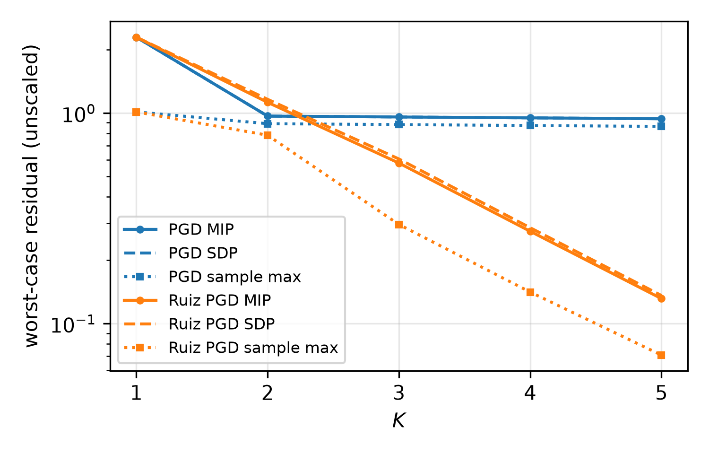

# NNLS: verifying equilibrated PGD in unscaled variables

Projected gradient descent (PGD) on a badly column-scaled nonnegative least
squares problem, verified with and without Ruiz equilibration. Real solvers
equilibrate internally but check termination on the original problem; this
experiment verifies the equilibrated method in exactly that way.

## Problem

$$
\begin{array}{ll}
\text{minimize} & \tfrac12 \lVert Az - x \rVert_2^2 \\
\text{subject to} & z \ge 0,
\end{array}
$$

with parameter $x \in [0, 1]^5$, $z^0 = 0$ and $K = 1, \dots, 5$.
$A = A_0 \operatorname{diag}(c) \in \mathbf{R}^{5 \times 3}$, where $A_0$ is
Gaussian (seed 3) and $c$ is log-spaced with $c_{\max}/c_{\min} = 30$.
This gives $\kappa(A^\top A) = 121.4$. The range is kept modest on purpose so
the MIP and SDP solvers stay well conditioned.

## Variants

| variant | iteration | step | residual map $H$ |
|---|---|---|---|
| PGD | $s^{k+1} = (s^k - tA^\top(As^k - x))_+$ | $t = 1/\lambda_{\max}(A^\top A) = 0.0151$ | $(1/t) I$ |
| Ruiz PGD | $\hat s^{k+1} = (\hat s^k - \hat t\hat A^\top(\hat A\hat s^k - x))_+$, $\hat A = AD$ | $\hat t = 1/\lambda_{\max}(\hat A^\top\hat A) = 0.701$ | $(1/\hat t) D^{-1}$ |

- **How `D` is computed:** $D$ is symmetric Ruiz equilibration of $A^\top A$
  (25 passes), giving $D = \operatorname{diag}(1.234, 0.370, 0.123)$ and
  $\kappa(\hat A^\top\hat A) = 2.3$.
- **Only columns are scaled:** the change of variables is $z = D\hat s$, and
  $\hat s \ge 0 \iff z \ge 0$. Rows are not scaled, because that would turn the
  problem into weighted least squares with a different solution. So $x$, and
  the parameter set, are the same for both variants.
- **Why the residuals are comparable:** the metric is
  $\lVert H(s^K - s^{K-1})\rVert_\infty$. For both variants,
  $H(s^K - s^{K-1})$ is the gradient-mapping residual of the *original*
  problem, measured in gradient units. The scaled gradient is
  $D\nabla f(z)$, so the equilibrated residual has to be unscaled by $D^{-1}$.
  Coordinate-wise it equals $\min(z_j/(\hat t D_j^2), \nabla f(z)_j)$, which
  is zero exactly when the KKT conditions hold. This makes the comparison fair.
- **Why the VP class doesn't change:** $A$ is fixed, so $D$ is a constant.
  Equilibration and unscaling are linear maps, and the VP is still an affine
  step plus a ReLU per iteration.

## Backends

- **MIP:** Gurobi, with Gurobi OBBT.
- **SDP:** Clarabel, with Gurobi OBBT, a single PSD cone, and RLT,
  ReLU-envelope, cross and triangle cuts. The default SDP relaxation is loose
  here and grows with $K$, so the extra cuts are needed.
- **Simulator:** 10,000 uniform samples of $x$; the plot shows the per-$K$
  sample maximum.

## Results

| K | PGD MIP | PGD SDP | PGD sample max | Ruiz MIP | Ruiz SDP | Ruiz sample max |
|---:|---:|---:|---:|---:|---:|---:|
| 1 | 2.2900 | 2.2900 | 1.0118 | 2.2900 | 2.2900 | 1.0118 |
| 2 | 0.9665 | 0.9665 | 0.8895 | 1.1233 | 1.1609 | 0.7841 |
| 3 | 0.9571 | 0.9571 | 0.8806 | 0.5784 | 0.6048 | 0.2955 |
| 4 | 0.9479 | 0.9479 | 0.8719 | 0.2744 | 0.2852 | 0.1412 |
| 5 | 0.9388 | 0.9388 | 0.8633 | 0.1314 | 0.1359 | 0.0709 |



- **The Ruiz bound drops about 2x per iteration**, while unscaled PGD stalls
  near 0.94. At $K = 5$ the certified worst case is 7x smaller.
- **$K = 1$ is identical for both variants.** From $z^0 = 0$, the first
  unscaled residual is $(A^\top x)_+$ regardless of $D$.
- **The SDP bound is exact (to solver tolerance) for PGD**, and within 3.5% of
  the MIP bound for Ruiz PGD.

## Reproduce

```sh
cd nnls
../.venv/bin/python verify.py   # results/bounds.csv (about 10 s)
../.venv/bin/python check.py    # sanity checks
../.venv/bin/python plot.py     # results/nnls_bounds.{pdf,png}, results/nnls_bounds_wide.csv
```

`check.py` confirms two things:
- Both variants converge to the NNLS solution from CVXPY with Clarabel, in the
  original variables.
- sampled residual ≤ MIP ≤ SDP for every variant and $K$.
