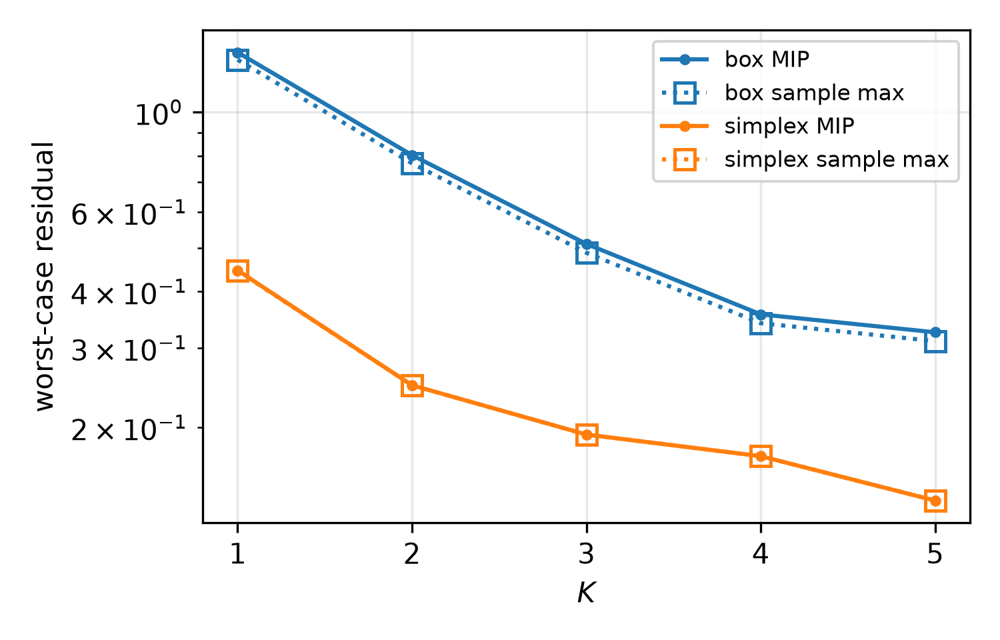

# Portfolio rebalancing: status (2026-09-30)

## Problem

$$
\begin{array}{ll}
\text{minimize} & \tfrac{\gamma}{2} z^\top \Sigma z - \mu^\top z + \kappa \lVert z - x \rVert_1 \\
\text{subject to} & \mathbf{1}^\top z = 1,\quad 0 \le z \le \bar z
\end{array}
$$

- **Parameter:** $x$ is the portfolio currently held. It was feasible last period, so it lies in the capped simplex $\{\mathbf{1}^\top x = 1,\ 0 \le x \le \bar z\}$.
- **Ablation:** the simplex compared with its bounding box $[0, \bar z]^n$. The two VPs differ by one `add_constraint(1ᵀx == 1)` call.
- **Data:** $n = 3$, $\gamma = 1$, $\kappa = 0.05$, $\bar z = 0.6$. $\Sigma = FF^\top/n + 0.1 I$ with Gaussian $F$, and $\mu \sim U[0, 0.5]$ (seed 0).
- **ℓ1 term:** written with an epigraph variable $\tau \ge |z - x|$, so $y = (z, \tau) \in \mathbf{R}^6$. There are 10 constraint rows: budget, position, sell ($z - \tau \le x$) and buy ($z + \tau \ge x$).
- **Algorithm:** OSQP-style ADMM with $\rho = 1$ and $\sigma = 10^{-4}$. The iterate is $s = (y, v) \in \mathbf{R}^{16}$.
  - Warm start at the current holdings: $z^0 = x$, $\tau^0 = 0$, $v^0 = My^0$.
  - The parameter enters only the one-sided bounds of the sell and buy rows. Those projections are written as $\min(v, x) = x - \mathrm{relu}(x - v)$ and $\max(v, x) = x + \mathrm{relu}(v - x)$, because `satlin` bounds must be constants.
  - Each iteration has 3 satlin, 6 ReLU and one 6×6 linear solve.
- **Metric:** the OSQP primal-dual residual $H(s^K - s^{K-1})$.
- **Check:** in a scratch script, ADMM agreed with the CVXPY/Clarabel solution to within $2\cdot 10^{-7}$ on 8 sampled $x$.

## MIP, infinity norm (the current plot)

Gurobi MIP with Gurobi OBBT. "Sample max" is the largest residual over 10,000 samples of $x$: uniform on the box, and uniform on the capped simplex (Dirichlet with rejection).

| K | box MIP | box sample max | simplex MIP | simplex sample max | box / simplex |
|---:|---:|---:|---:|---:|---:|
| 1 | 1.355 | 1.305 | 0.446 | 0.445 | 3.0x |
| 2 | 0.802 | 0.769 | 0.248 | 0.248 | 3.2x |
| 3 | 0.510 | 0.488 | 0.193 | 0.193 | 2.6x |
| 4 | 0.356 | 0.340 | 0.173 | 0.173 | 2.1x |
| 5 | 0.325 | 0.311 | 0.138 | 0.138 | 2.4x |

MIP solve times:

| K | box | simplex |
|---:|---:|---:|
| 1 | 0.02 s | 0.02 s |
| 2 | 0.05 s | 0.04 s |
| 3 | 0.07 s | 0.06 s |
| 4 | 0.23 s | 0.06 s |
| 5 | 4.43 s | 0.09 s |

The full run, both sets up to $K = 5$ plus sampling, takes about 5 s.

## SDP

Clarabel with Gurobi OBBT and all five cuts: RLT, triangle, ReLU envelope, cross, and subgradient monotonicity. $K = 1$ to $3$. All SDP numbers were run on fomtools `b63c275`, which includes the OBBT changes listed at the end of this section, with no local patches.

### Objective: use the two-norm

The infinity-norm objective is unusable in the SDP. `_apply_infinity_norm_objective` builds $\lVert r \rVert_\infty$ from a chain of $3 \cdot 16 - 1 = 47$ ReLUs: $|r_i| = \mathrm{relu}(r_i) + \mathrm{relu}(-r_i)$, followed by a running max. It then puts all 47 in one PSD cone. On the box at $K = 1$, with RLT only, that took 148 s and was 59% above the MIP. With every cut on, it had not finished after 24 CPU-minutes, at about 5 GB.

All SDP results below use `set_objective_norm(..., ord=2)`, which reports the **squared** 2-norm. The MIP is run with the same objective for comparison. For the MIP that makes it a nonconvex MIQP, which is slower than the infinity norm, although it stays cheap on the simplex.

| K | simplex sample max | simplex MIP | time | box sample max | box MIP | time |
|---:|---:|---:|---:|---:|---:|---:|
| 1 | 0.656 | 0.657 | 0.04 s | 5.149 | 5.557 | 0.01 s |
| 2 | 0.240 | 0.241 | 0.69 s | 2.219 | 2.417 | 1.1 s |
| 3 | 0.168 | 0.168 | 0.81 s | 1.334 | 1.458 | 11.6 s |

### Results (simplex)

Values are squared 2-norms. Times are per solve.

| K | MIP | full PSD cone | time | chordal, cut cones dropped | time | chordal, cut cones kept | time | chordal, RLT only | time |
|---:|---:|---:|---:|---:|---:|---:|---:|---:|---:|
| 1 | 0.657 | 0.775 | 4.2 s | 0.775 | 3.9 s | 0.775 | 3.8 s | 0.777 | 3.7 s |
| 2 | 0.241 | 0.254 | 36 s | 0.405 | 8.4 s | 0.255 | 126 s | 0.617 | 9.8 s |
| 3 | 0.168 | 0.171 | 146 s | 0.398 | 16.8 s | not finished (5 min cap) | – | 1.036 | 12.5 s |

SDP / MIP in norm terms:

| K | full PSD cone | cut cones dropped | cut cones kept | RLT only |
|---:|---:|---:|---:|---:|
| 1 | 1.09 | 1.09 | 1.09 | 1.09 |
| 2 | 1.03 | 1.30 | 1.03 | 1.60 |
| 3 | 1.01 | 1.54 | – | 2.48 |

- **Full PSD cone** (`full_psd_cone=True`): this is the tightest relaxation, 1–9% above the MIP in norm terms, and the gap shrinks with K. It is also the only variant whose bound falls with K the way the true worst case does.
- **Chordal, cut cones kept** (the default): it matches the full cone at K = 2 but is slower (126 s against 36 s), and it didn't finish K = 3 within 5 minutes (peak 6.4 GB in an earlier run).
- **Chordal, cut cones dropped:** the cones that the cut builders register are discarded. It is fast (17 s at K = 3), but the cross-step cuts become vacuous and the gap grows with K.
- **Chordal, RLT only:** it is fast, but the gap grows fastest.
- **K = 1 is the same for every variant.** With one step, the chordal cones already contain everything the full cone does.

### Box, full PSD cone

| K | MIP | full PSD cone | time | SDP / MIP (norm) |
|---:|---:|---:|---:|---:|
| 1 | 5.557 | 6.044 | 4.7 s | 1.04 |
| 2 | 2.417 | 2.4172 | 23 s | 1.00 |
| 3 | 1.458 | 1.4582 | 107 s | 1.00 |

It is exact at K ≥ 2.

### Clarabel's own chordal decomposition (simplex, K = 1 to 4)

This uses the chordal cut set, with RLT only on the pairs in fomtools' per-step cones and no per-cut cones. It is passed to Clarabel with a single PSD cone over $X$, and Clarabel's built-in decomposition and clique-graph merging produce the cones (on by default in Clarabel 0.11.1). This is a scratch patch of the solve path (`scratchpad/clarabel_dual.py`). fomtools is unchanged.

To be equivalent to the full cone, the problem is solved through its **dual**. A zero row in Clarabel's PSD slack fixes that entry to 0, so simply dropping unused entries of $X$ would restrict it rather than leave it free. In the dual, the PSD slack is $D^{-1}(q + A^\top y)$, whose unused entries really are zero, and $X$ is Clarabel's dual variable, which lies in the PSD-completable cone. Checked on the full-cone problem at K = 1: 0.7785 through the dual against 0.7749 through the normal path.

Squared 2-norm. The ratio is SDP against the sample max over 10,000 samples, in norm terms.

| K | sample max | SDP | SDP / sample max (norm) | time | size of $X$ | pattern entries used | Clarabel cones after merging (sizes) |
|---:|---:|---:|---:|---:|---:|---:|---|
| 1 | 0.656 | 0.781 | 1.09 | 3.5 s | 57 | 1,551 of 1,653 | 23, 54 |
| 2 | 0.240 | 0.254 | 1.03 | 14 s | 91 | 3,078 of 4,186 | 23, 54, 66 |
| 3 | 0.168 | 0.172 | 1.01 | 44 s | 125 | 4,965 of 7,875 | 23, 54, 54, 87 |
| 4 | 0.115 | 0.118 | 1.01 | 90 s | 159 | 7,212 of 12,720 | 6 cones, largest 102 |

- **Same quality as the full PSD cone,** within 1% where both were run (K ≤ 3), and about 3x faster (44 s against 146 s at K = 3).
- **K = 5 didn't finish** inside a 5-minute cap on the whole run, after K = 1–4 had used about 150 s. Its $X$ is 193×193 with 9,819 of 18,721 entries used, and its largest merged cone is 123.
- **The largest cone grows about linearly with K** (54 → 66 → 87 → 102 → 123), because the cross-step cuts keep connecting every step into one clique. Keeping the pattern banded, for example with cross cuts only between adjacent steps, would be needed to scale further.
- **Every solve ended "AlmostSolved",** meaning reduced accuracy. A certified bound would need a feasibility check or a certified dual bound.

### Why the cost grows

The number of cuts grows about linearly in K. What makes the chordal version expensive is the number of PSD cones.

| | K = 1 | K = 2 | K = 3 |
|---|---:|---:|---:|
| cuts, RLT only | 5,752 | 10,580 | 15,408 |
| cuts, all five (chordal) | 5,914 | 11,245 | 16,917 |
| cuts, all five (full cone) | 6,322 | 16,685 | 32,013 |
| cones, RLT only (sizes) | 23, 54 | 23, 54, 54 | 23, 54, 54, 54 |
| cones, all five (chordal) | 2 | 16 (12 of size 42) | 43 (36 of size 42) |
| PSD entries, RLT only | 1,761 | 3,246 | 4,731 |
| PSD entries, all five (chordal) | 1,761 | 15,117 | 40,344 |
| full cone size | 57 | 91 | 125 |

- **RLT is about 90% of the cuts.** It adds 4 cuts per pair of variables in a common cone, and each ADMM step adds one cone of size 54.
- **The cross and subgradient cuts each register their own PSD cone** so that their cross-step products bind. Those overlapping cones take the PSD entries from 4,731 to 40,344 at K = 3.
- **Without those cones, a cross-step cut is valid but vacuous.** Entries of $X$ outside every cone are free variables in the Clarabel formulation.
- At this size, one merged full cone is cheaper than the chordal pieces. Reaching K = 5 would need fewer, better-chosen cross-step cones.

### Package changes (in fomtools `b63c275`)

1. **Triangle and ReLU-envelope cuts use the OBBT bounds.** Before, `_build_triangle_cuts` and `_build_relu_envelope_cuts` recomputed the ReLU input bounds by interval propagation from the leaf boxes, which can't see the simplex budget. They should use the intersection of `step.lb/ub` with the propagated bounds.
2. **OBBT reaches affine step outputs.** Before, `Affine.sync_output_bounds` recomputed output bounds by interval propagation through $A^{-1}\,\mathrm{arg}$ and discarded the OBBT-tightened input bounds. This affected the linear-solve output and the trajectory leaves $s^k$, and tightening them narrows their summed box widths 3–4x.
3. **Small crossings in OBBT results are repaired.** A crossing of about 2e-17 made a later `stack` raise "Lower bound cannot exceed upper bound".

## Minor

The Gurobi OBBT instance ignores `params={"OutputFlag": 0}` and prints a full log for every tightening LP. It does not affect results, but it buries the output.
